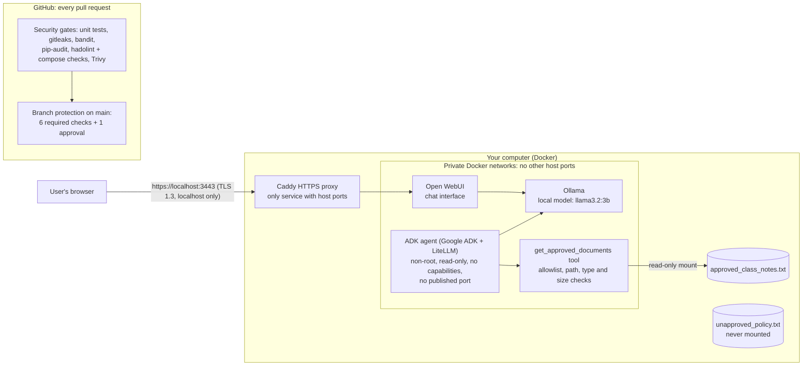

# G-ForceX: Private AI Document Assistant

A cybersecurity capstone project (CSEC 2300, University of the Incarnate Word). Users ask questions about
**approved** documents. A language model running **locally** in Docker answers them, so document text is
not sent to an external AI service.

> Educational project for a controlled lab environment. All documents in this repository are fictional.

## Architecture



- **Open WebUI and the ADK agent are separate.** Both use the same local Ollama, but Open WebUI does
  **not** call the agent yet. The agent is used from the command line, as shown below.
- Ollama, Open WebUI and the agent publish **no ports** to your computer. The browser reaches Open WebUI only
  through the HTTPS proxy, and only from this machine (`127.0.0.1`). See [docs/encryption.md](docs/encryption.md).
- The agent can read only files mounted into `/data/approved`. Today that is just `approved_class_notes.txt`.

## Quickstart

**Requirements:** Docker Desktop (with Docker Compose), Git, and about 4 GB free disk space for the model.
The model runs on CPU, so answers can take 10–60 seconds.

1. **Clone the repository and enter it.**
   ```bash
   git clone https://github.com/sophilyn/csec2300_G--ForceX.git
   ```
   ```bash
   cd csec2300_G--ForceX
   ```

2. **Create your `.env` file with a random Open WebUI secret key.** `.env` is ignored by Git, so the key is
   never committed. This writes the key without printing it:
   ```bash
   cp .env.example .env && sed -i.bak "s/^WEBUI_SECRET_KEY=.*/WEBUI_SECRET_KEY=$(openssl rand -hex 32)/" .env && rm .env.bak
   ```

3. **Start the stack.** The first run builds the agent image.
   ```bash
   docker compose up -d --build
   ```
   If you see `port is already allocated` for port 3000 or 3443, another program (often a different Open WebUI)
   is using it. Stop that program, then run the command again. If you see `required variable WEBUI_SECRET_KEY
   is missing a value`, you skipped step 2.

4. **Download the model into Ollama (one time).**
   ```bash
   docker compose exec ollama ollama pull llama3.2:3b
   ```

5. **Ask the ADK agent a question.**
   ```bash
   docker compose exec adk-agent python -m gforcex_agent.run_query "What is the fictional lab network named?"
   ```
   The agent answers from `approved_class_notes.txt` and lists the tools it called.

6. **Optional: open the chat interface** at <https://localhost:3443>. (<http://localhost:3000> redirects
   there.) The first start can take 1–2 minutes. The browser warns about the certificate the first time,
   because it comes from the project's own local certificate authority. The connection is still encrypted.
   To remove the warning, see [docs/encryption.md](docs/encryption.md). Create the first account, which
   becomes the admin.

**Stop everything:** `docker compose down`. Your model and Open WebUI data are kept in Docker volumes.

## Testing

| What | Command | Needs Ollama? |
|---|---|---|
| Unit tests (allowlist, path traversal, symlinks, retry logic) | `python3 -m unittest discover -s agent/tests -p 'test_*.py'` | No |
| Real agent ↔ Ollama tests (answers correctly, never leaks the unapproved file) | `docker compose exec -e GFORCEX_INTEGRATION=1 adk-agent python -m unittest discover -s /app/tests -p 'test_integration.py' -v` | Yes |
| Indirect prompt-injection suite (4 attacks, 5 runs each, about 15 minutes) | `docker compose exec adk-agent python /app/tests/run_injection_suite.py --runs 5` | Yes |
| Network firewall test (13 allowed and blocked connections) | `bash tests/network/check_network.sh` | Stack running |
| Encryption test (TLS 1.3, HTTP redirect, secret key handling) | `bash tests/encryption/check_tls.sh` | Stack running |

Results and methodology for the injection suite are in [docs/prompt-injection-tests.md](docs/prompt-injection-tests.md).
Every pull request also runs the CI security gates in
[.github/workflows/security-gates.yml](.github/workflows/security-gates.yml).

## Security controls

### Implemented and tested

| Control | How it is enforced | Evidence | SY0-701 domain |
|---|---|---|---|
| Least-privilege document access | Agent has one tool with no arguments. The tool enforces a file-name allowlist, resolved-path containment (blocks `..` and symlink escapes), `.txt`/`.md` only, and size limits. Only the approved file is mounted, read-only. | `agent/tests/test_tools.py`, integration no-leak test | 3.0 Security Architecture |
| Network minimization | Only the HTTPS proxy publishes host ports, bound to `127.0.0.1`. The agent is on an internal network with no internet. CI fails any PR that breaks these rules. | `docker-compose.yml`, CI job "Dockerfile lint and Compose validation", blocked-merge demo PR #40 | 3.0 Security Architecture |
| Container hardening | Agent runs as non-root (UID 10001) with a read-only filesystem, all Linux capabilities dropped, and `no-new-privileges`. The agent's base image is pinned by digest; Ollama and Open WebUI are pinned by version tag. | `agent/Dockerfile`, `docker-compose.yml`, Trivy config scan | 4.0 Security Operations |
| Prompt-injection mitigation | Documents are wrapped as untrusted data. Fake closing tags inside a document are removed, and a reminder follows the documents. Tested with 4 attacks. **Not complete:** one attack still changes the reply. | `docs/prompt-injection-tests.md` | 2.0 Threats, Vulnerabilities, and Mitigations |
| Encryption in transit | The browser reaches Open WebUI only through a hardened Caddy HTTPS proxy (TLS 1.3, HSTS). Plain HTTP only redirects. Open WebUI has no host port. Container-to-container HTTP on private networks is accepted as RA-003. | `docs/encryption.md`, `tests/encryption/check_tls.sh`, CI network and Caddyfile checks | 1.0 General Security Concepts |
| Secrets management | Open WebUI secret key is read from an ignored `.env` file, and Compose refuses to start without it. `.gitignore` blocks keys, certificates and env files. gitleaks scans every PR. | `.gitignore`, `.env.example`, CI jobs "Secret scan" and "Secret key is required" | 4.0 Security Operations |
| Vulnerability management | bandit (code), pip-audit (dependencies), hadolint (Dockerfile), and Trivy (container image and config) run on every PR and fail on findings. | CI job logs on each PR | 4.0 Security Operations |
| Risk acceptance with expiry | Any ignored vulnerability needs a register entry with an owner and review date. CI fails after the date passes. | `docs/risk-acceptance.md` | 5.0 Security Program Management and Oversight |
| Change management | `main` requires all 6 security checks to pass and 1 approving review before merge. | Branch protection settings, blocked-merge demo PR #40 | 1.0 General Security Concepts |
| Security monitoring and audit logs | The agent writes a JSON audit log: questions (secrets redacted), document access linked to each question by `query_id`, refusals, and outcomes. It never logs document contents or answers. A review script reads the audit log and Open WebUI's log together and alerts on 3+ refused file requests, failed queries, tampered lines, or 5+ failed sign-ins. All Docker logs are size-limited, which CI enforces. | `docs/audit-logging.md`, `tests/logging/check_audit_logs.sh`, `tests/logging/review_logs.sh` | 4.0 Security Operations |

### Tested manually by the team
These controls were tested by hand in a team member's Windows environment, not by CI. Full write-up:
[Security Testing Results Wiki page](https://github.com/sophilyn/csec2300_G--ForceX/wiki/Security-Testing-Results-%E2%80%93-Milestone-4).

| Control | Team result | Evidence | SY0-701 domain |
|---|---|---|---|
| Firewall configuration | Passed with limitations: Windows Firewall on, Open WebUI localhost-only, Ollama port not published | [#10](https://github.com/sophilyn/csec2300_G--ForceX/issues/10) | 3.0 Security Architecture |
| Security monitoring and audit logs | Passed initial tests: Open WebUI logs record activity; sampled logs did not contain test secrets | [#15](https://github.com/sophilyn/csec2300_G--ForceX/issues/15) | 4.0 Security Operations |
| Data backup and recovery | Passed: sample documents and config backed up and restored; AES-256 encrypted USB backup verified | [#17](https://github.com/sophilyn/csec2300_G--ForceX/issues/17) | 3.0 Security Architecture |
| Access control (Open WebUI) | Partially passed: unapproved project code not revealed; one response did not clearly refuse | [#12](https://github.com/sophilyn/csec2300_G--ForceX/issues/12) | 4.0 Security Operations |
| Vulnerability scanning (Open WebUI image) | Improved in a separate test image: patched image had 0 fixable critical findings | [#20](https://github.com/sophilyn/csec2300_G--ForceX/issues/20) | 4.0 Security Operations |
| Data encryption | Partially completed: device encryption on, encrypted backup, `.env` not tracked; service-to-service traffic is HTTP without TLS | [#23](https://github.com/sophilyn/csec2300_G--ForceX/issues/23) | 1.0 General Security Concepts |
| Incident response | Passed a fictional exposed-API-key exercise | [#26](https://github.com/sophilyn/csec2300_G--ForceX/issues/26), [Incident Response Plan](https://github.com/sophilyn/csec2300_G--ForceX/wiki/G-FORCE-X-%E2%80%93-Incident-Response-Plan) | 4.0 Security Operations |

### Planned (not done yet)
- Full application recovery from backup, including Docker volumes (#17 follow-up)
- TLS between containers: accepted for now as RA-003 (Ollama has no built-in TLS). The browser connection uses TLS.
- Decide whether the patched Open WebUI image replaces the current one (#20 follow-up)
- Connecting Open WebUI to the ADK agent so chat questions also go through the document allowlist

## Known limitations
- **Prompt-injection protection is not complete.** A small local model can still follow instructions hidden
  in a document. The agent's file access stayed limited in every test.
- Open WebUI's own document upload does **not** use the agent's allowlist.
- Open WebUI currently logs `CORS_ALLOW_ORIGIN` as `*` (any origin). Restricting it to localhost is planned.
- On CPU, Ollama requests sometimes time out. The tests report these as errors, not as passes or failures.
- Development used Claude Code, an AI coding assistant that runs on Anthropic's cloud. The application's own
  model runs only locally in Ollama.

## Repository layout

| Path | Contents |
|---|---|
| `docker-compose.yml` | HTTPS proxy, Ollama, Open WebUI, and the hardened ADK agent |
| `proxy/Caddyfile` | HTTPS proxy configuration (TLS, HTTP redirect) |
| `agent/gforcex_agent/` | Agent definition, allowlisted document tool, command-line runner |
| `agent/tests/` | Unit, integration, and prompt-injection tests |
| `docs/` | Control write-ups (firewall, audit logging, encryption), prompt-injection results, risk-acceptance register |
| `.github/workflows/security-gates.yml` | CI security gates |
| `approved_class_notes.txt` / `unapproved_policy.txt` | Fictional test documents (only the first is mounted) |

## Project team

| Member | Contributions verified in Git history and issue assignments |
|---|---|
| Sophia Gomez (`sophilyn`) | Repository setup and README; created the user-story task issues; firewall (#10) and access-control (#12) testing; backup (#17) and encryption (#23) testing with Karlie; HTTPS proxy and required secret key (#48); audit-log question linking and sign-in alerts (#50); pull-request reviews, approvals and merges; `main` branch protection |
| Karlie Garcia (`karliegj28`) | Docker Compose setup; ADK agent and allowlisted document tool; CI security gates; CVE fixes and risk register; prompt-injection test suite; ADK 2.x upgrade; network segmentation (#46), audit logging (#47), encrypted backup and recovery (#49, #51), incident response runbook and drill (#52); logging (#15), vulnerability scanning (#20), and incident response (#26) testing; backup (#17) and encryption (#23) testing with Sophia; README and Wiki final report |

This table lists work visible in commits, pull requests, issue assignments, and Wiki history.
Much of the implementation was developed with Claude Code, an AI coding assistant; those commits are marked
`Co-Authored-By: Claude`, and every pull request was reviewed and approved by a team member.

## Individual Contribution Summary Table

Story points come from the user stories (label `user-story`) on the
[project board](https://github.com/users/sophilyn/projects/3). **All 20 user stories are co-assigned to both
members**, so each story's points are split equally.

| Member | GitHub | Story points | Contribution |
|---|---|---:|---:|
| Sophia Gomez | `sophilyn` | 45.5 | 50% |
| Karlie Garcia | `karliegj28` | 45.5 | 50% |
| **Total** | | **91** | **100%** |

<details>
<summary>Story points per user story (from the project board, 2026-11-19)</summary>

| Story | Points | Iteration | | Story | Points | Iteration |
|---|---:|---|---|---|---:|---|
| #1 Choose our security controls | 3 | 1 | | #53 Private AI agent on approved documents | 8 | 3 |
| #8 Basic network protection | 3 | 2 | | #57 CI security gates | 5 | 3 |
| #11 Limit access to approved documents | 5 | 2 | | #60 Prompt-injection tests and defenses | 5 | 3 |
| #14 Keep track of important events | 3 | 2 | | #62 Network segmentation | 3 | 3 |
| #16 Back up important files | 3 | 2 | | #64 Audit logging and log review | 5 | 3 |
| #18 Find software security problems | 5 | 2 | | #67 HTTPS for browser traffic | 5 | 3 |
| #22 Protect sensitive information | 8 | 2 | | #69 Encrypted backup and full recovery | 5 | 3 |
| #24 Incident response plan | 5 | 2 | | #72 Incident response runbook and drill | 3 | 3 |
| #27 Show that our controls work | 5 | 2 | | #74 README | 2 | 3 |
| | | | | #77 Wiki final report | 5 | 3 |
| | | | | #78 Final presentation and demo | 5 | 4 |

</details>
