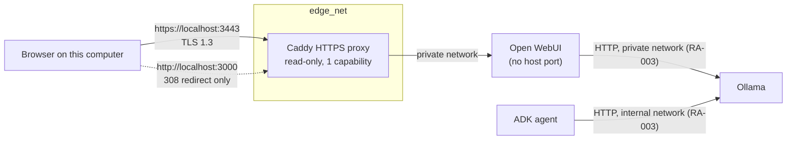

# Control 6: Data encryption

**Type:** Preventive · **SY0-701:** 1.0 General Security Concepts, 3.0 Security Architecture · **Status:** implemented and tested on 2026-11-18

## Goal (from our control plan, issue #25)
> Use HTTPS/TLS where appropriate, enable suitable storage encryption for sensitive data, and keep passwords
> and encryption keys out of the GitHub repository. Verify the encryption settings and confirm that protected
> connections or stored data use the intended encryption mechanisms.

## Sensitive data and how each item is protected

The data list comes from the team's analysis in issue #23. The agent's audit log (Control 2) was added later.

| Data | Where it is stored | Encrypted at rest | Encrypted in transit |
|---|---|---|---|
| User accounts and passwords | `webui_data` volume (Open WebUI database). Passwords are stored hashed | Host disk encryption | Browser ↔ Open WebUI: **TLS 1.3** |
| Chats (questions and answers) | `webui_data` volume | Host disk encryption | Browser ↔ Open WebUI: **TLS 1.3**. Open WebUI ↔ Ollama: HTTP on a private network (RA-003) |
| Uploaded and approved documents | `webui_data` volume. `approved_class_notes.txt` is mounted read-only into the agent | Host disk encryption | Agent ↔ Ollama: HTTP on an internal network with no internet (RA-003) |
| Agent audit log (contains questions, with secrets redacted) | `agent_audit` volume | Host disk encryption | Not sent anywhere |
| Open WebUI secret key | `.env` on the host (ignored by Git) | Host disk encryption | Never sent. CI fails if Compose would start without it |
| HTTPS certificate private keys | `caddy_data` volume | Host disk encryption | Never sent |
| Backups | Encrypted USB drive | **AES-256** (issue #17) | Copied locally |

## Encryption in transit: the HTTPS proxy



| Rule | How it is enforced |
|---|---|
| The browser reaches Open WebUI only over TLS | The `proxy` service (Caddy) is the only service with host ports. Open WebUI has no `ports:`. CI fails a pull request that publishes an Open WebUI port |
| Plain HTTP carries no app traffic | Port 3000 only answers with a `308` redirect to `https://localhost:3443` |
| The browser keeps using HTTPS | `Strict-Transport-Security` (HSTS) header |
| Only this computer can connect | Both proxy ports are bound to `127.0.0.1`. CI checks this |
| The proxy cannot reach the model or the agent | The proxy is only on `edge_net`, shared with Open WebUI. CI checks this |
| The proxy is hardened | Read-only filesystem, all Linux capabilities dropped except `NET_BIND_SERVICE`, `no-new-privileges`, no admin API, image pinned by digest |
| The configuration is valid | CI runs `caddy validate` on `proxy/Caddyfile` |

**Certificates:** Caddy's `tls internal` creates a local certificate authority (CA) and certificates for
`localhost` and `127.0.0.1`. Server certificates are short-lived and renewed automatically. The keys stay in
the `caddy_data` volume and are never committed.

**Browser warning:** browsers do not trust the local CA at first, so the first visit shows a certificate
warning. The connection is still encrypted. To remove the warning on your own computer, export the public root certificate:
```bash
docker compose cp proxy:/data/caddy/pki/authorities/local/root.crt ./gforcex-local-ca.crt
```
Then import it as a trusted root on your own computer: Windows *Manage user certificates → Trusted Root
Certification Authorities*, or macOS *Keychain Access → System*. Only do this on your own machine.
`*.crt` files are not committed. Delete the exported file afterwards.

**Between containers:** Ollama has no built-in TLS. The team accepted plain HTTP on the private Docker
networks as **RA-003** in `docs/risk-acceptance.md`, which lists the compensating controls and a review date.

## Encryption at rest
- **Windows test machine:** Windows Device Encryption is on. Docker Desktop stores its data (all volumes
  above) on `C:`, so the volumes are covered (issue #23).
- **macOS test machine:** not yet verified. Run `fdesetup status` and expect `FileVault is On.`
- **Backups:** AES-256 encrypted USB backup, verified (issue #17).

## Keys and secrets
- `WEBUI_SECRET_KEY` is read from `.env`, which Git ignores. `.env.example` has an empty value.
- `docker compose` **refuses to start** if the key is missing or empty
  (`${WEBUI_SECRET_KEY:?...}`). Before this change, a missing `.env` (as found on one team machine in #23)
  silently gave Open WebUI an empty key. CI checks that Compose fails without the key.
- `.gitignore` blocks `.env*`, `*.key`, `*.pem`, and `*.crt`. gitleaks scans the full Git history on every pull request.

## How to test
With the stack running, from the repository root:
```bash
bash tests/encryption/check_tls.sh
```
It exits 0 only when every check passes, and never prints the secret key.

## Evidence (Windows 11, Docker 29.8.0, Compose 5.5.1, 2026-11-18)

**Before:** Open WebUI was published directly as `127.0.0.1:3000 -> 8080` over plain HTTP. Run against the old
Compose file, the CI network check fails with `open-webui publishes a host port (3000); only proxy may`.

**After:** `bash tests/encryption/check_tls.sh`, all checks passed, exit code 0:
```
== Encryption in transit (browser <-> Open WebUI) ==
PASS  https://localhost:3443 uses TLSv1.3 (TLS_AES_128_GCM_SHA256), certificate verified for localhost
PASS  https://127.0.0.1:3443 uses TLSv1.3 (TLS_AES_128_GCM_SHA256), certificate verified for 127.0.0.1
PASS  Open WebUI answers through the HTTPS proxy (/health -> 200 {"status":true})
PASS  HSTS header tells the browser to use HTTPS only (max-age=31536000)
PASS  http://localhost:3000 only redirects to HTTPS (308 -> https://localhost:3443/some/page)
PASS  plain HTTP sent to the HTTPS port does not reach Open WebUI
PASS  Open WebUI publishes no plain-HTTP port of its own
== Secrets and keys ==
PASS  docker compose refuses to start without WEBUI_SECRET_KEY
PASS  Open WebUI's secret key is set and at least 32 characters (value not printed)
PASS  .env is not tracked by Git
PASS  no private keys or certificates are committed (the proxy's keys live in the caddy_data volume)
== Result: all checks passed ==
```
With the proxy stopped, the same script reports 4 FAIL lines and exits 1, so it does detect a broken setup.

The network firewall test (`tests/network/check_network.sh`) still passes after the change: **13 passed, 0 failed**.

## Limitations
- Traffic between containers is plain HTTP on private Docker networks (RA-003).
- The certificate comes from a local CA, so browsers warn until a user trusts it on their own machine.
- Encryption at rest depends on each team member's disk encryption. The Mac is not yet verified.
- Open WebUI still has internet access through `webui_net` (see `docs/network-firewall.md`).
