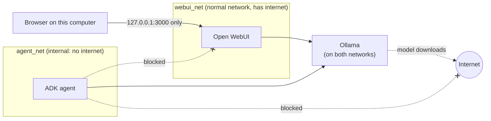

# Control 1: Firewall configuration (network segmentation)

**Type:** Preventive · **SY0-701:** 3.0 Security Architecture · **Status:** implemented and tested on 2026-11-17

> **Update 2026-11-18 (Control 6):** Open WebUI no longer publishes a port. The browser reaches it only
> through a Caddy **HTTPS proxy**, the only service with host ports: `127.0.0.1:3443` (TLS) and
> `127.0.0.1:3000` (redirect to HTTPS). The proxy sits on a new `edge_net` with Open WebUI only, so it cannot
> reach Ollama or the agent. The CI rules and `check_network.sh` were updated to match (now 13 checks,
> **13 passed, 0 failed** on Windows). The LAN check also now finds the LAN IP correctly on Windows. Before,
> `hostname -I` failed there and the check passed without testing anything. The design table and evidence
> below are from 2026-11-17, before this change. See `docs/encryption.md`.

> **Update 2026-11-19 (Open WebUI → agent):** a new internal network, `agent_api_net`, links **only** Open WebUI
> and the ADK agent, so chats go through the agent. Every request needs a shared API key. The agent stays
> without internet or host ports. CI now allows Open WebUI and the agent to share a network only if it is
> internal and has no other service on it. Docker networks are not one-way, so the agent can open a connection
> to Open WebUI's port on that link; `check_network.sh` reports this as INFO. The live test now probes from
> each container with whatever tool it has (python3, bash or nc) and reports "untestable" instead of
> "blocked" when it cannot run. See `docs/openwebui-agent.md`.

## Goal (from our control plan)
> Configure Docker networking and firewall rules to limit access to the ports our application needs.
> Verify that approved connections work and that unauthorized connections to restricted ports are blocked.

## Design
Docker enforces these rules with its own firewall rules between container networks.



| Rule | How it is enforced |
|---|---|
| Only Open WebUI is reachable from the computer, and only on `127.0.0.1:3000` | `ports: "127.0.0.1:3000:8080"`. Ollama and the agent have no `ports:`. |
| Other devices on the network cannot reach the app | The port is bound to `127.0.0.1`, not `0.0.0.0` |
| Open WebUI can reach Ollama | Both are on `webui_net` |
| The ADK agent can reach Ollama | Both are on `agent_net` |
| The ADK agent cannot reach the internet | `agent_net` is `internal: true` |
| The ADK agent and Open WebUI cannot reach each other | They share no network |
| Ollama can reach the internet to download models | Ollama is on `webui_net`. **Team decision on 2026-11-17**, so model downloads keep working. |

## How to test
With the stack running, from the repository root:
```bash
bash tests/network/check_network.sh
```
Each probe only opens and closes a TCP connection, and no data is sent. It exits 0 only when every check matches.

## Evidence (macOS, Docker 29.7.2, Compose 5.4.0)

**Before:** all containers were on Compose's single `default` network. 7 passed, **3 failed**:
```
PASS  expected open    got open                          Browser on this computer -> Open WebUI (127.0.0.1:3000)
PASS  expected open    got open                          Open WebUI -> Ollama (ollama:11434)
PASS  expected open    got open                          ADK agent -> Ollama (ollama:11434)
PASS  expected blocked got blocked (not published)       This computer -> Ollama container (any port)
PASS  expected blocked got blocked (not published)       This computer -> ADK agent container (any port)
PASS  expected blocked got blocked (localhost only)      Open WebUI published on any address but 127.0.0.1
PASS  expected blocked got blocked (ConnectionRefusedError)  Other devices on the network -> Open WebUI (LAN IP:3000)
FAIL  expected blocked got open                          ADK agent -> Open WebUI (open-webui:8080)
FAIL  expected blocked got open                          Open WebUI -> ADK agent (adk-agent:8000)
FAIL  expected blocked got open                          ADK agent -> internet (1.1.1.1:443)
```

**After:** segmented networks. **10 passed, 0 failed**, exit code 0:
```
PASS  expected open    got open                          Browser on this computer -> Open WebUI (127.0.0.1:3000)
PASS  expected open    got open                          Open WebUI -> Ollama (ollama:11434)
PASS  expected open    got open                          ADK agent -> Ollama (ollama:11434)
PASS  expected blocked got blocked (not published)       This computer -> Ollama container (any port)
PASS  expected blocked got blocked (not published)       This computer -> ADK agent container (any port)
PASS  expected blocked got blocked (localhost only)      Open WebUI published on any address but 127.0.0.1
PASS  expected blocked got blocked (ConnectionRefusedError)  Other devices on the network -> Open WebUI (LAN IP:3000)
PASS  expected blocked got blocked (gaierror)            ADK agent -> Open WebUI (open-webui:8080)
PASS  expected blocked got blocked (gaierror)            Open WebUI -> ADK agent (adk-agent:8000)
PASS  expected blocked got blocked (OSError)             ADK agent -> internet (1.1.1.1:443)
```

**The app still works after the change:**
- Open WebUI `/health` returned `200 {"status":true}`.
- The ADK agent answered "The fictional lab network is named Bluebird." using `get_approved_documents`.

## CI enforcement
Every pull request runs `tests/network/check_compose_network.py` against the resolved Compose config. The PR fails if:
- any service other than Open WebUI publishes a port;
- Open WebUI is published on an address other than `127.0.0.1`;
- the agent is on a network that is not internal;
- the agent and Open WebUI share a network.

Its unit tests (`tests/network/test_check_compose_network.py`) prove that each rule catches a bad change. Run against the old Compose file, the check reports the two problems that segmentation fixed.

## Host firewall
- The team's Windows test environment had Windows Firewall enabled (issue #10).
- On the Mac used for this test, a separate **Ollama desktop app** (outside this project) was listening on `127.0.0.1:11434`. It accepts only local connections. The test checks what the G-ForceX containers publish, so the desktop app cannot hide a G-ForceX problem. Quit the desktop app if it is not needed.
- Host firewall settings (Windows Firewall, macOS firewall) are changed by each team member on their own machine. They are not part of this repository.

## Limitations
- Ollama can reach the internet (team decision, for model downloads). A compromised Ollama container could make outbound connections.
- Traffic between containers is plain HTTP inside Docker's private networks, without TLS (see Control 6, issue #23).
- Open WebUI still has general internet access through `webui_net`.
- Docker Desktop on macOS and Windows runs containers inside a VM. These results show Docker's network rules, not a host-level firewall.
