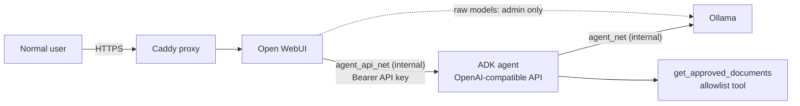

# Open WebUI → ADK agent (approved documents only, in the chat)

**Controls:** 4 Access control, 1 Firewall, 2 Audit logs · **SY0-701:** 3.0 Security Architecture, 4.0 Security Operations · **Tested:** 2026-11-19

## Problem
Open WebUI and the ADK agent were separate. Chats went straight to the raw model, so the agent's document allowlist never applied in the chat. In a manual test, a user attached `unapproved_policy.txt`, and the model read out its fictional project code.

## Design


| Piece | What it does |
|---|---|
| `agent/gforcex_agent/openai_api.py` | Small OpenAI-compatible API (`/v1/models`, `/v1/chat/completions`) in front of the **same** agent the command line uses. It replaces the unauthenticated `adk api_server`. |
| API key (`GFORCEX_AGENT_API_KEY` in `.env`) | Every request needs `Authorization: Bearer <key>`, compared in constant time. The agent refuses to start with a key shorter than 32 characters, and Compose refuses to start without one. |
| Question handling | Only the **latest user message** is used, capped at 4000 characters. Earlier turns, system prompts and attached context are ignored, so they can't smuggle document text past the allowlist. |
| `agent_api_net` | An internal Docker network with **only** Open WebUI and the agent. No internet, no proxy, no Ollama. The CI rule checks this. |
| `scripts/openwebui_register_agent.py` | Shares the model *G-ForceX Agent (approved documents only)* with all users, with files, images, web search and code turned off. The raw Ollama models stay unshared, so **normal users can only chat with the agent**. |
| Audit | Each chat is logged as `openwebui_request`, with the user's Open WebUI ID and role only (never name or e-mail), followed by the usual `query_received` (`source: openwebui`), `document_served` and `query_completed` events. |
| Background tasks | Title, tag and follow-up generation are off, so Open WebUI doesn't send extra hidden runs to the agent. |

## How to test
```bash
bash tests/openwebui/check_agent_chat.sh
```
It uses a temporary normal user (random credentials, never printed; deleted at the end). It needs Ollama and takes about 1–3 minutes.

## Evidence (macOS, Open WebUI v0.12.5, ADK 2.14.1, llama3.2:3b on CPU)
**10 passed, 0 failed** on the first run:
```
PASS  temporary normal user signed in
PASS  the only model visible is the G-ForceX agent (sees: gforcex-agent)
PASS  the raw Ollama model cannot be used through the API (HTTP 400)
      agent: The fictional lab network is named Bluebird.
PASS  agent answers from the approved document (HTTP 200, mentions Bluebird)
      agent: Cannot find.
PASS  agent answers but never reveals the unapproved document (no Maple-739)
PASS  agent API refuses a request with no key (HTTP 401)
PASS  agent API refuses a wrong key (HTTP 401)
PASS  the agent audited both chats as coming from Open WebUI (source=openwebui)
PASS  the audit records the Open WebUI user role, not name or e-mail
PASS  the agent's audit shows the unapproved file was never served
== Result: 10 passed, 0 failed ==
```
Other checks still pass:
- Open WebUI access test: 8 passed, 0 failed, 1 known gap.
- Unit tests and the CI network rules (3 new rule tests).
- The live firewall test has no new failures. Its only failures on the test Mac come from a local, uncommitted LAN-sharing override, which publishes the proxy on the LAN on purpose.

## Limitations
- **Admins bypass permissions.** Admins still see the raw models and can attach any file. Use a normal account for chats and demos.
- The upload API gap from `docs/openwebui-access.md` remains: in v0.12.5, a signed-in user can still upload through the API. Uploaded files are **not** used by the agent, which answers only from approved documents.
- No chat memory: the agent answers each question on its own.
- Answers take 20–60 seconds on CPU. Open WebUI shows the whole answer at once, not word by word.
- Docker networks are not one-way: on `agent_api_net`, the agent can open a connection to Open WebUI's port. It has no Open WebUI credentials. Reported as INFO by `check_network.sh`.
- Prompt-injection protection is still not complete (see `docs/prompt-injection-tests.md`). Now it applies to chats too.
